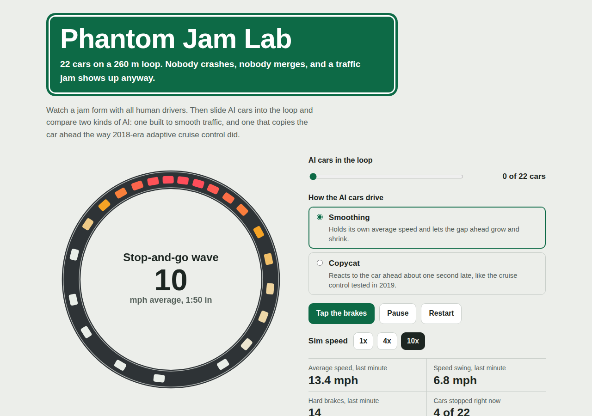

# Phantom Jam Lab

A browser simulation of the phantom traffic jam. Twenty-two cars drive around a one-lane loop with no crash, merge or bottleneck, one driver taps the brakes, and a stop-and-go wave appears anyway. Slide AI drivers into the loop to see which kinds of AI smooth the wave and which make it worse, and watch a machine-learning model forecast jams a minute before they start.



**[Try it live](https://siroxou.github.io/phantom-jam-lab/)**, or open `index.html` in any browser. There is nothing to install and no server to run.

## What it found

Averages of 10 runs per setup, from `npm run experiments`:

| Who is driving | Average speed (mph) | Speed swing (mph) | Hard brakes per minute | Time stopped (%) |
| --- | --- | --- | --- | --- |
| All 22 human | 10.4 | 8.8 | 44 | 25 |
| 1 smoothing AI car | 16.1 | 1.2 | 0 | 0 |
| 2 smoothing AI cars | 16.0 | 0.8 | 0 | 0 |
| 1 copycat car | 9.6 | 9.2 | 46 | 32 |
| All 22 copycat | 4.4 | 8.8 | 22 | 72 |
| All 22 smoothing AI | 9.7 | 0.9 | 0 | 0 |

- One smoothing AI car in 22 took the speed swing from 8.8 mph to 1.2 mph and ended hard braking. A real 2016 experiment in Tucson saw the same direction with one automated car: 50 to 81 percent less speed swing and 22 to 43 percent less fuel.
- A copycat car, modeled on a 2018 adaptive cruise control system, made the jam slightly worse. A loop of 22 copycats was the worst setup tested.
- Twenty-two smoothing AI cars gave smooth traffic that crawled at 9.7 mph, because each one copies its own past speed and nobody sets the pace.
- The jam forecaster scored 0.82 AUC against 0.70 for a simple rule of thumb, but only about half of its alerts came true.

Details: [results](docs/results.md), [how the simulation works](docs/how-it-works.md), [forecaster model card](docs/forecaster.md).

## Try it

1. Open `index.html` and watch for a few seconds. At the 3 second mark one driver taps the brakes and a red wave forms.
2. Set **AI cars in the loop** to 1 and watch the wave fade.
3. Switch the AI to **Copycat**, press **Tap the brakes**, and watch the waves come back.
4. Keep an eye on the jam risk gauge, which forecasts a jam in the next minute.

The live copy at <https://siroxou.github.io/phantom-jam-lab/> is served by GitHub Pages straight from `index.html` on `main`.

## Run the code

Needs Node 18 or newer. There are no npm packages to install.

```bash
git clone https://github.com/siroxou/phantom-jam-lab.git
cd phantom-jam-lab
npm test               # 6 behavior checks on the simulation and forecaster, about 1 s
npm run experiments    # the results table above, 60 runs in a few seconds
npm run calibrate      # the driver-setting sweep used to match the Tucson experiment
npm run build          # rebuilds index.html after you change anything in src/ or model/
```

Retraining the forecaster also needs Python 3:

```bash
npm run dataset                    # 2,500 simulated runs to data/jam_windows.csv, about 45 s
pip install -r requirements.txt
npm run train                      # compares three forecasters, writes model/model.json
npm run forecast-check             # field test on 300 runs the model never saw
npm run build
```

Every script is deterministic. The dataset, model weights and tables above reproduce exactly.

## How it works

Human drivers follow the Intelligent Driver Model with a little random noise, tuned so the loop is unstable: a small slowdown grows as it passes from car to car. The smoothing AI uses the controller from the Tucson experiment, driving at its own recent average speed and letting the gap ahead stretch and shrink. The copycat AI is a delayed cruise-control model with response settings fitted to a real 2018 car. The forecaster is a logistic regression on nine features of the last 20 seconds of traffic, embedded in the page as nine weights and a formula. [docs/how-it-works.md](docs/how-it-works.md) has the equations and parameters.

## Repository layout

```
index.html                 built page, open this
src/sim.js                 ring-road simulation: human, smoothing AI and copycat drivers
src/features.js            forecast features and risk formula, shared by the page and the scripts
src/template.html          page source; scripts/build.js inlines the code and model to make index.html
scripts/experiments.js     results and calibration tables
scripts/dataset.js         training data for the forecaster
scripts/forecast-check.js  field test for the forecaster
model/train.py             trains and compares the forecasters
model/model.json           trained logistic regression used by the page
tests/sim.test.js          behavior checks (Node's built-in test runner)
docs/                      how it works, results, forecaster model card
.github/workflows/ci.yml   runs the tests and fails if index.html is out of date with src/
```

## Limitations

- One lane, no exits, no lane changes and no trucks. On a real expressway, other drivers would cut into the gap a smoothing car leaves.
- The human drivers follow a textbook model. The lab's speed gains come out larger than the real experiment's, likely because the simulated drivers stop completely more often.
- The forecaster was trained and tested on simulated traffic only.
- The lab does not model fuel use.

## Sources

1. Sugiyama, Y. et al. (2008). [Traffic jams without bottlenecks: experimental evidence for the physical mechanism of the formation of a jam](https://doi.org/10.1088/1367-2630/10/3/033001). *New Journal of Physics* 10, 033001.
2. Stern, R. E. et al. (2018). [Dissipation of stop-and-go waves via control of autonomous vehicles: Field experiments](https://arxiv.org/abs/1705.01693). *Transportation Research Part C* 89, 205-221.
3. Gunter, G. et al. (2019). [Are commercially implemented adaptive cruise control systems string stable?](https://arxiv.org/abs/1905.02108) Preprint, later published in *IEEE Transactions on Intelligent Transportation Systems*.
4. Treiber, M., Hennecke, A. and Helbing, D. (2000). [Congested traffic states in empirical observations and microscopic simulations](https://doi.org/10.1103/PhysRevE.62.1805). *Physical Review E* 62, 1805.
5. Trafton, A. (2009). [Mathematicians take aim at "phantom" traffic jams](https://news.mit.edu/2009/traffic-0609). MIT News.
6. Manke, K. (2022). [Massive traffic experiment pits machine learning against "phantom" jams](https://news.berkeley.edu/2022/11/22/massive-traffic-experiment-pits-machine-learning-against-phantom-jams/). Berkeley News.

## About

Built by Anas Ahmed (Siro) for the SCI 1000 curiosity project at St. John's University, fall 2026. The code was written with Claude (Anthropic) in one working session, and every number in this repo comes from the scripts in it. [GitHub](https://github.com/siroxou) | [LinkedIn](https://www.linkedin.com/in/anas-ai-engineering)

## License

MIT. See [LICENSE](LICENSE).
