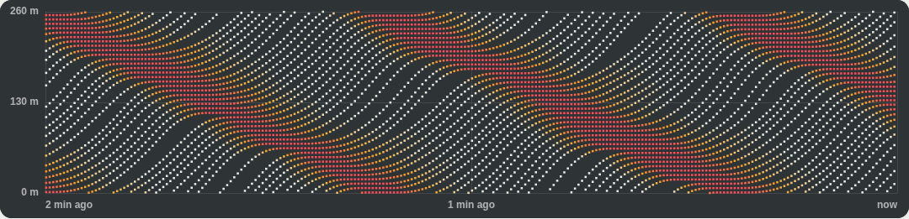

# How it works

The lab runs 22 cars around a one-lane loop 260 m long, the same size as the 2016 Tucson experiment (Stern et al. 2018). Every 0.1 s of simulated time, each car picks an acceleration from what it can see: its own speed, the gap to the car ahead and that car's speed. Positions then update assuming constant acceleration over the step. Cars are 5 m long and start evenly spaced at 7.5 m/s (17 mph), with up to 0.2 m of random offset so no run starts perfectly balanced. All of this lives in [`src/sim.js`](../src/sim.js).

## Human drivers

Each human follows the Intelligent Driver Model (Treiber, Hennecke and Helbing 2000):

$$
a = a_{\max}\left[1 - \left(\frac{v}{v_0}\right)^{4} - \left(\frac{s^{*}}{s}\right)^{2}\right],
\qquad
s^{*} = s_0 + vT + \frac{v\,\Delta v}{2\sqrt{a_{\max}\,b}}
$$

Here $v$ is the car's speed, $s$ the gap to the car ahead and $\Delta v$ how fast the car is closing on it.

| Parameter | Value |
| --- | --- |
| Comfortable acceleration $a_{\max}$ | 1.0 to 1.6 m/s², random per driver |
| Comfortable braking $b$ | 1.5 m/s² |
| Time gap $T$ | 0.6 to 0.8 s, random per driver |
| Minimum gap $s_0$ | 1.5 m |
| Desired speed $v_0$ | 20 m/s |

On top of that, each driver carries a slowly drifting attention error with a standard deviation of 0.3 m/s² (an Ornstein-Uhlenbeck process with a 2 s time constant). The acceleration range was tuned so the loop roughly matches the Tucson numbers; see [calibration](results.md#calibration).

With these settings the loop is string unstable: a small slowdown grows as it passes from car to car. That is why one brake tap is enough to start a stop-and-go wave.

## Smoothing AI

This follows the "PI with saturation" controller that damped waves in the Tucson experiment. The car never sees the whole loop. It estimates the average speed of traffic from its own recent speed and drives at that pace, letting the gap ahead stretch when the car in front speeds up and shrink when it slows down.

1. $U$ is a running average of the car's own speed with a 30 s time constant.
2. The target speed is $U$, plus up to 1 m/s more as the gap grows from 7 m to 30 m, so the car closes big gaps instead of falling behind.
3. A blend weight $\alpha$ rises from 0 to 1 as the gap goes from a safety distance (4 m, or 2 s times the closing speed if that is larger) to 2 m beyond it. Close in, the car matches the car ahead. Further out, it follows its target.
4. The commanded speed updates as $v_{cmd} \leftarrow \beta\,[\alpha\,v_{target} + (1-\alpha)\,v_{lead}] + (1-\beta)\,v_{cmd}$ with $\beta = 1 - \alpha/2$.
5. Acceleration is $0.6\,(v_{cmd} - v)$ when speeding up and $1.2\,(v_{cmd} - v)$ when slowing down, capped by an Intelligent Driver Model safety floor ($T$ = 0.5 s, $s_0$ = 2 m, $b$ = 3 m/s²) and kept between -6 and 1.5 m/s².

## Copycat AI

A delayed cruise-control model (optimal velocity with relative velocity) of the kind Gunter et al. fitted to seven 2018 cars with adaptive cruise control. All seven turned out to amplify slowdowns.

$$
a(t) = k_1\left[s(t-\tau) - \eta - t_h\,v(t)\right] + k_2\left[v_{lead}(t-\tau) - v(t)\right]
$$

| Parameter | Lab | Gunter et al., vehicle A, closest following setting |
| --- | --- | --- |
| $k_1$ | 0.05 1/s² | 0.052 1/s² |
| $k_2$ | 0.34 1/s | 0.338 1/s |
| Time gap $t_h$ | 0.8 s | 0.819 s |
| Sensor delay $\tau$ | 0.95 s | 0.948 s |
| Standstill gap $\eta$ | 2 m | 8.03 m |

The standstill gap is shorter than the fitted value so the car can move at all with 22 cars on a 260 m loop. The copycat also gets small sensor noise (0.05 m/s²) and the same safety floor as the smoothing AI, standing in for automatic emergency braking.

## Brake taps

**Tap the brakes** forces one human driver to brake at 3.5 m/s² for 1.5 s. The page does this once on its own at 3 s. The experiments use a 2 s tap by car 3 at 3 s.

## What the readouts measure

| Readout | Definition |
| --- | --- |
| Average speed | Mean of every car's speed over the last 60 s |
| Speed swing | Standard deviation of every car's speed over the last 60 s, pooled across cars and time |
| Hard brakes | Braking harder than 2 m/s² while moving faster than 0.5 m/s, counted once per event |
| Cars stopped | Cars under 0.5 m/s right now |
| Stop-and-go wave | The spread of speeds across cars tops 2.5 m/s, the threshold Stern et al. used to flag waves |

The label in the middle of the ring averages that spread over the last 5 s. Above 2.5 m/s reads as a stop-and-go wave, 1.2 to 2.5 m/s as ripples building, and anything lower as smooth flow.

## Why the jam moves backward

Each dotted line is one car going around the loop, with position going up and time running left to right. Where cars stop, the dots pile up and turn red. Cars leave the front of a jam while new ones arrive at its back, so the red band slides down the chart, against traffic. In this capture each band falls about one loop length in roughly a minute, which puts the backward speed near 4 to 5 m/s (about 10 mph). Sugiyama et al. (2008) measured about 20 km/h (12 mph) on their test track and noted that jams on real highways move back at about the same speed. MIT mathematicians later named these waves jamitons and found their equations closely resemble those for detonation waves (Trafton 2009).

## The page

`index.html` is one self-contained file. [`scripts/build.js`](../scripts/build.js) inlines `src/sim.js`, `src/features.js` and the weights from `model/model.json` into `src/template.html`. The page samples the loop every 0.5 s of simulated time for the readouts, the time-space diagram and the forecaster. The only network request is the Overpass web font, and the page falls back to a system font offline.
